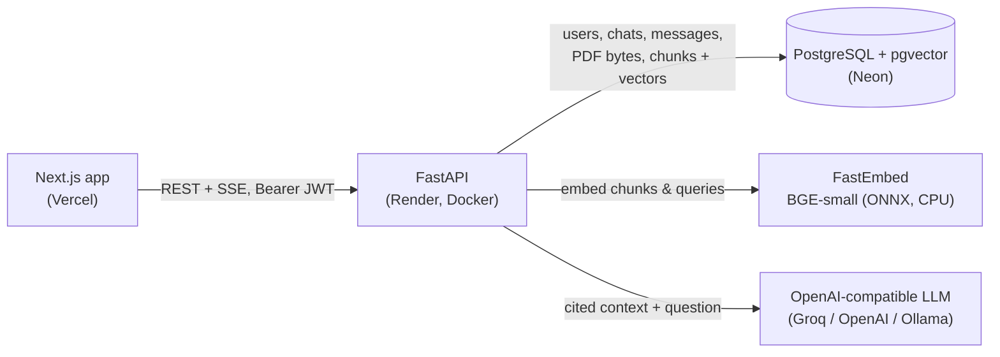

# Pagewise: ask your PDFs, see the page

Pagewise is a full-stack retrieval-augmented generation (RAG) app. You upload lecture notes, papers or a thesis, then ask questions in plain language.

- Answers come **only from your documents**.
- Answers stream in as they are written.
- Every claim cites its source. Clicking a citation opens the PDF at that page with the passage highlighted.

**Stack:** Next.js 15 (React 19, TypeScript, Tailwind CSS 4) · FastAPI · PostgreSQL + pgvector · FastEmbed (BGE-small) · any OpenAI-compatible LLM (Groq, OpenAI, Ollama) · Docker · GitHub Actions

> Live demo: _add your Vercel URL here_ · Demo GIF: _add `docs/demo.gif` here_

## Features

- **Streaming chat with citations.**
  - Answers arrive token by token over Server-Sent Events.
  - Inline `[1]` citations open the source page.
  - A source list shows the exact passages that were used.
- **PDF viewer with highlights.**
  - The cited page renders in a side panel (react-pdf), with the retrieved passage highlighted in the text layer.
- **Saved conversations.**
  - Chats and messages live in the database. You can rename or delete them.
  - Follow-up questions use recent history, and short follow-ups are expanded with the previous question for better retrieval.
- **Choose what to search.** Each chat can search all documents or only the ones you pick.
- **Background ingestion.**
  - Uploads return immediately while parsing, chunking and embedding run in the background.
  - The UI polls for status. Failed files show why, and can be retried.
- **Accounts.**
  - Email and password (bcrypt + JWT), plus optional **Sign in with Google**.
  - A Google sign-in links to an existing account with the same email.
  - Every query is scoped to the signed-in user.
- **Grounded by design.**
  - If no passage clears a similarity threshold, the app says "not found" and skips the LLM call.
  - The prompt treats document text as data, not instructions.
- **Works without an LLM key.** In retrieval-only mode it returns the most relevant passages instead of a generated answer.

## Architecture



**Ingestion:** upload → store PDF → *(background)* pypdf text per page → ~800-character chunks with 150 overlap, never crossing pages → BGE embeddings → `chunks` table.

**Question:** embed the question → pgvector cosine search over the chat's documents → drop hits below `MIN_SCORE` → stream the LLM answer with numbered context → save the answer and its sources.

### Design decisions

| Decision | Why |
|---|---|
| pgvector instead of a separate vector DB | One database holds users, chats, files and vectors, so deleting a document cascades everywhere. It's also free on Neon |
| PDFs stored in Postgres (`bytea`) | The API server is stateless, so free hosts that wipe their disk on every deploy lose nothing |
| FastEmbed (ONNX) instead of sentence-transformers | No PyTorch, so the API fits in the 512 MB of a free Render instance |
| Page-bounded chunks | Every chunk maps to exactly one page, which makes citations and highlighting precise |
| SSE over `fetch`, not WebSockets | One-way streaming is all that's needed. It works through proxies, and the auth header is sent normally |
| Relevance threshold before the LLM | Off-topic questions get an honest "not found" and cost nothing |
| SQLite fallback | `pytest` and local development need no database server, and CI runs the same suite against Postgres too |
| Bearer token in `localStorage` | Simple across separate frontend and API domains. The trade-off is XSS exposure compared with httpOnly cookies, which is acceptable for this project |

## Run it locally

### Option A: two terminals, no Docker (SQLite)

```bash
# 1. API
cp .env.example .env                      # set SECRET_KEY; add LLM_API_KEY for generated answers
python3.12 -m venv .venv && source .venv/bin/activate
pip install -r backend/requirements-dev.txt
cd backend && uvicorn app.main:app --reload       # http://localhost:8000/docs

# 2. Web app (new terminal)
cd frontend
cp .env.example .env.local
npm install
npm run dev                                       # http://localhost:3000
```

The first API start downloads the embedding model (about 70 MB).

### Option B: everything in Docker (Postgres + pgvector)

```bash
cp .env.example .env
docker compose up --build                 # web app on :3000, API on :8000
```

## Deploy for free

1. **Database (Neon).**
   - Create a project at neon.tech and copy the connection string.
   - Nothing else is needed: the API runs `CREATE EXTENSION vector` itself.
2. **API (Render).**
   - New → Blueprint → select this repo. `render.yaml` defines the service.
   - Fill in `DATABASE_URL`, `LLM_API_KEY` and `CORS_ORIGINS` (your Vercel URL).
   - Free instances sleep after 15 minutes idle, so the first request then takes about a minute.
3. **Web app (Vercel).**
   - Import the repo and set **Root Directory** to `frontend`.
   - Add the environment variable `NEXT_PUBLIC_API_URL`, set to the Render URL.
4. **Google sign-in (optional).**
   - In Google Cloud Console → APIs & Services → Credentials, create an *OAuth client ID* (Web application).
   - Add `http://localhost:3000` and your Vercel URL as authorised JavaScript origins.
   - Set the same client ID as `GOOGLE_CLIENT_ID` on Render and `NEXT_PUBLIC_GOOGLE_CLIENT_ID` on Vercel.

## API

| Method | Path | Description |
|---|---|---|
| `POST` | `/auth/register` | Create an account and get a token |
| `POST` | `/auth/login` | OAuth2 password form. Returns a token |
| `POST` | `/auth/google` | Exchange a Google ID token for a token |
| `GET` | `/auth/me` | Current user |
| `POST` | `/documents` | Upload a PDF. Returns `202`, and processing continues in the background |
| `GET` | `/documents` | List documents with status (`processing` / `ready` / `failed`) |
| `GET` | `/documents/{id}/file` | Original PDF |
| `POST` | `/documents/{id}/retry` | Re-process a failed document |
| `DELETE` | `/documents/{id}` | Delete a document, its file and its vectors |
| `GET` | `/chats` | List chats |
| `POST` | `/chats` | Create a chat. Optional `document_ids` limits what it searches |
| `GET` | `/chats/{id}` | A chat with its messages and sources |
| `PATCH` | `/chats/{id}` | Rename, or change searched documents |
| `DELETE` | `/chats/{id}` | Delete a chat |
| `POST` | `/chats/{id}/messages` | Ask a question. **SSE stream** of `sources`, `token`, `done` or `error` events |

Interactive docs are at `/docs`.

## Quality

```bash
cd backend && pytest            # runs offline; CI also runs it against Postgres + pgvector
```

The tests cover:

- auth, including Google account linking
- per-user isolation for documents and chats
- upload validation and the background-processing lifecycle
- retrieval picking the right document
- the "not found" path skipping the LLM
- the streamed event format
- the exact messages sent to the LLM (mocked)
- error handling when the LLM fails

They use a deterministic fake embedder and generate PDFs in memory.

### Retrieval benchmark

Every pull request runs a retrieval benchmark in CI. It uses 48 questions over a 9-page set of Operating Systems notes in `backend/eval/` (original text, written for this benchmark). Each question names the page and a short evidence phrase that a correct passage must contain.

- The scores appear on the GitHub Actions run page.
- The build fails if they drop below `backend/eval/thresholds.json`.

| chunk size / overlap | hit@1 | hit@3 | hit@5 | MRR |
|---|---|---|---|---|
| 800 / 150 (default) | 800 / 150 | 19 | 85.4% | 95.8% | 97.9% | 0.903 | | |
| 500 / 100 | | | | |
| 120 / 0 (close to the old line-by-line chunking) | | | | |

Run it locally, or on your own PDFs:

```bash
cd backend
python -m scripts.eval_retrieval --configs 800:150,500:100,120:0
python -m scripts.eval_retrieval --pdf notes.pdf --questions my-questions.jsonl -v
```

`hit@k` is the share of questions whose correct passage is in the top *k* results. `MRR` is the mean of 1/rank of the first correct passage.

## Limitations and next steps

- Scanned or image-only PDFs need OCR (e.g. Tesseract), which isn't supported yet.
- Background jobs run in the API process. A production setup would use a queue (RQ/Celery) and a worker.
- Hybrid search (BM25 + vectors) and a cross-encoder re-ranker would improve retrieval on keyword-heavy questions.
- Schema changes use `create_all`. Alembic migrations would be the next step.
- An HNSW index on `chunks.embedding` would help at large scale. Exact search is used now because it's accurate with per-user filters.

## Author

Built by **Sanvi Shan and Harshit Mishra**
